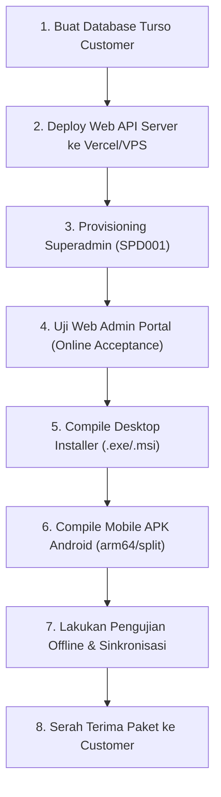

# Buku Panduan Lengkap & Manual Operasional Aplikasi Absensi SPPG
### (Web Admin Cloud, Desktop Local-First Client, & Mobile Android APK)

---

## DAFTAR ISI

1. [BAB 1: Ikhtisar Arsitektur & Keunggulan Sistem](#bab-1-ikhtisar-arsitektur--keunggulan-sistem)
2. [BAB 2: Panduan Step-by-Step Developer Sebelum Menyerahkan Aplikasi ke Customer](#bab-2-panduan-step-by-step-developer-sebelum-menyerahkan-aplikasi-ke-customer)
3. [BAB 3: Panduan Setup Awal & Onboarding Customer (Administrator Guide)](#bab-3-panduan-setup-awal--onboarding-customer-administrator-guide)
4. [BAB 4: Panduan Pemakaian & Fitur Aplikasi (Web, Desktop, & Mobile)](#bab-4-panduan-pemakaian--fitur-aplikasi-web-desktop--mobile)
5. [BAB 5: Panduan Dynamic ID Card Studio & Desain Kartu Karyawan](#bab-5-panduan-dynamic-id-card-studio--desain-kartu-karyawan)
6. [BAB 6: Standar Operasional Prosedur (SOP) & Aturan Scanner QR](#bab-6-standar-operasional-prosedur-sop--aturan-scanner-qr)
7. [BAB 7: Aturan Bisnis, Time Policy Guard, & Logika Kalkulasi Kehadiran](#bab-7-aturan-bisnis-time-policy-guard--logika-kalkulasi-kehadiran)
8. [BAB 8: Panduan Pemeliharaan, Backup, & Troubleshooting Mandiri (FAQ)](#bab-8-panduan-pemeliharaan-backup--troubleshooting-mandiri-faq)

---

## BAB 1: Ikhtisar Arsitektur & Keunggulan Sistem

Aplikasi **Absensi SPPG** adalah platform manajemen presensi modern berbasis **Multi-Client & Local-First Architecture**, yang dirancang untuk kehandalan 100% tanpa takut gangguan jaringan internet (zero-downtime offline operational).

```text
┌────────────────────────────────────────────────────────────────────────┐
│                   CLOUD SERVER & DATABASE (TURSO LIBSQL)               │
│         Next.js 16 Backend API · Web Portal · Master Synchronization   │
└───────────────────────────────────┬────────────────────────────────────┘
                                    │
           ┌────────────────────────┴────────────────────────┐
           ▼                                                 ▼
┌─────────────────────────────────────┐   ┌─────────────────────────────────────┐
│      DESKTOP CLIENT (TAURI v2)      │   │      MOBILE ANDROID (TAURI v2)      │
│  • Front Desk / PC Pos Keamanan     │   │  • Smartphone Android / Tablet      │
│  • USB Barcode Scanner & Webcam     │   │  • Kamera Belakang ZXing + Torch    │
│  • Local SQLite (rusqlite WAL)      │   │  • Background GPS Geofencing        │
│  • Full Offline Bi-directional Sync │   │  • Haptic Vibration & Voice Synth   │
└─────────────────────────────────────┘   └─────────────────────────────────────┘
```

### Keunggulan Utama Aplikasi:
1. **Local-First & Offline Resilience**: Transaksi absensi disimpan instan di SQLite lokal berformat WAL dalam hitungan milidetik. Antrean *Outbox Pattern* akan otomatis mengirimkan data ke Cloud saat koneksi internet pulih tanpa terjadi data hilang (*zero data loss*).
2. **Zero-Default Credentials & Provisioning Satu Kali**: Tidak ada akun bawaan default (*zero default password*) seperti `admin/123456`. Aplikasi pertama kali mengharuskan pembuatan akun Superadmin mandiri melalui formulir *Provisioning Satu Kali* dengan standar password kuat min 12 karakter.
3. **Offline Security Vault**: Mengamankan kredensial operator lokal dan token database dengan enkripsi standar militer **AES-256-GCM** yang diturunkan dari algoritma hashing **Argon2id**. Operator dapat login tanpa internet selama batas waktu yang ditentukan.
4. **Dynamic ID Card Studio & Designer (Baru)**: Fitur perancang tata letak kartu identitas standar CR80 (Depan & Belakang) visual interaktif (WYSIWYG) dengan penyesuaian logo, background kustom, QR code, tanda tangan digital, stempel resmi, dan cetak lembar grid A4 massal.
5. **Company Profile & Identitas Terpadu (Baru)**: Pengaturan profil instansi (Nama, Alamat, Kontak, Logo, Tanda Tangan Direktur, Stempel) yang otomatis terintegrasi ke kartu ID Card dan laporan kehadiran.
6. **Time Policy Guard (Anti-Manipulasi Jam)**: Menolak kecurangan manipulasi jam di perangkat pengguna menggunakan validasi *Monotonic Hardware Clock* backend Rust dan referensi server cloud.
7. **GPS Geofencing Real-Time**: Memvalidasi radius lokasi fisik scan terhadap koordinat kantor/lokasi kerja yang ditentukan.
8. **Dukungan Multi-Shift & Shift Malam (Night Shift)**: Perhitungan jam kerja lintas hari (misal masuk 22:00, pulang 06:00 subuh) dengan toleransi keterlambatan, istirahat, dan lembur.
9. **Otomasi Generate Alfa Harian**: Sistem secara cerdas menandai karyawan yang tidak hadir setelah batas waktu shift berakhir, dan otomatis mengabaikannya pada hari libur nasional/khusus.
10. **Role-Based Access Control (RBAC)**: Pembagian wewenang ketat antara *Superadmin*, *Admin*, *Manajer*, dan *Petugas Operator Scanner*.

---

## BAB 2: Panduan Step-by-Step Developer Sebelum Menyerahkan Aplikasi ke Customer

Sebagai pengembang/penjual aplikasi, ikuti **Checklist 8 Langkah Wajib** berikut sebelum menyerahkan aplikasi ke pembeli:



### Langkah 1: Buat Database Cloud Turso Khusus Customer
Setiap customer wajib memiliki database mandiri (*isolated tenant*).
1. Buka terminal developer dan login ke Turso:
   ```powershell
   turso auth login
   ```
2. Buat database baru khusus customer (contoh: `sppg-pt-makmur`):
   ```powershell
   turso db create sppg-pt-makmur --location sin
   ```
3. Catat URL database:
   ```powershell
   turso db show sppg-pt-makmur --url
   # Contoh: libsql://sppg-pt-makmur-username.turso.io
   ```
4. Buat Token Autentikasi Server:
   ```powershell
   turso db tokens create sppg-pt-makmur
   ```
5. Simpan URL dan Token ini di Password Manager Anda. **JANGAN PERNAH** memberikan token ini kepada pihak tidak berwenang atau menanamnya secara hardcoded di binary release.

---

### Langkah 2: Deploy Backend Server Web ke Vercel atau VPS
1. Buat project baru di Vercel atau VPS yang mengarah ke direktori `web-desktop`.
2. Masukkan Environment Variables **(Server-Side Only, tanpa prefix NEXT_PUBLIC_)**:
   - `TURSO_DATABASE_URL` = `libsql://sppg-pt-makmur-username.turso.io`
   - `TURSO_AUTH_TOKEN` = `<token-server-turso>`
   - `NODE_ENV` = `production`
3. Deploy project dan hubungkan domain resmi customer (contoh: `https://absensi.ptmakmur.co.id` atau subdomain `https://sppg-pt-makmur.vercel.app`).
4. Pastikan SSL/HTTPS aktif dengan sempurna.

---

### Langkah 3: Inisialisasi Skema & Provisioning Superadmin Pertama
Database baru yang masih kosong **wajib** menjalankan inisialisasi skema dan pembuatan akun Superadmin pertama (`SPD001`). Anda dapat memilih salah satu dari 2 metode:

#### Metode A: Melalui Antarmuka Provisioning Satu Kali (Sangat Direkomendasikan)
1. Buka URL Web customer di browser: `https://absensi.ptmakmur.co.id`.
2. Sistem otomatis mendeteksi bahwa belum ada Superadmin dan langsung menampilkan antarmuka **Provisioning Satu Kali**.
3. Masukkan data Superadmin pertama:
   - **Nama Lengkap**: Contoh *"Superadmin PT Makmur"*.
   - **Username**: Contoh `superadmin` atau `admin.makmur`.
   - **Password Kuat**: Wajib minimal 12 karakter (kombinasi huruf besar, huruf kecil, angka, simbol khusus, dan tidak memuat username).
   - **Ulangi Password**: Masukkan konfirmasi password yang sama.
4. Klik tombol **Aktifkan Superadmin**.
5. Sistem akan menginisialisasi 12 tabel snapshot operasional (`master_data`, `id_card`, `tbl_shift`, `tbl_hari_libur`, `setting_gex_system`, `company_profile`, `id_card_template`, `backup_karyawan`, `koreksi_admin`, `import_offline`, `absensi_harian`, `log_scan`) secara atomik dalam transaksi `BEGIN IMMEDIATE` dan menutup form provisioning secara permanen.

#### Metode B: Melalui Terminal CLI Developer
1. Buka terminal di folder `web-desktop`:
   ```powershell
   cd e:\Freelance\absensi-sppg-app\web-desktop
   ```
2. Jalankan perintah bootstrap:
   ```powershell
   $env:TURSO_DATABASE_URL="libsql://sppg-pt-makmur-username.turso.io"
   $env:TURSO_AUTH_TOKEN="<token-server-turso>"
   $env:SPPG_SUPERADMIN_NAME="Superadmin PT Makmur"
   $env:SPPG_SUPERADMIN_USERNAME="superadmin"
   $env:SPPG_SUPERADMIN_PASSWORD="GantiPasswordKuat2026!"

   bun run bootstrap:superadmin
   ```
3. Segera bersihkan password dari terminal PowerShell:
   ```powershell
   $env:SPPG_SUPERADMIN_PASSWORD=""
   ```

> [!TIP]
> **Pemulihan Darurat Jika Lupa Password / Akun Terkunci**:
> Jika di kemudian hari customer lupa password Superadmin atau akun terkunci karena batas kesalahan login (*rate limit*), jalankan skrip reset interaktif:
> ```powershell
> cd e:\Freelance\absensi-sppg-app\web-desktop
> bun run reset:superadmin
> ```

---

### Langkah 4: Uji Web Admin Portal (Online Acceptance)
1. Buka URL Web customer di browser: `https://absensi.ptmakmur.co.id/login`.
2. Login dengan akun Superadmin yang baru saja dibuat saat provisioning.
3. Verifikasi bahwa halaman Dashboard, Karyawan, Shift, Hari Libur, ID Card (Visual Studio), Master Operator, Operasional, Riwayat, dan Pengaturan (Profil Instansi) dapat diakses dengan lancar.

---

### Langkah 5: Kompilasi Release Desktop Installer (.exe / .msi)
1. Buka terminal di folder `web-desktop`:
   ```powershell
   cd e:\Freelance\absensi-sppg-app\web-desktop
   ```
2. Set konfigurasi build terikat ke domain customer:
   ```powershell
   $env:SPPG_API_BASE_URL="https://absensi.ptmakmur.co.id"
   $env:SPPG_OFFLINE_AUTH_MAX_AGE_HOURS="720"
   bun run tauri:build
   ```
3. Ambil file installer hasil build di:
   `web-desktop/src-tauri/target/release/bundle/nsis/Absensi SPPG_0.1.0_x64-setup.exe`
4. Beri nama file yang rapi: `Absensi-SPPG-Desktop-Setup-PT-Makmur.exe`.

---

### Langkah 6: Kompilasi Release Mobile APK Android (.apk)
1. Buka terminal di folder `mobile`:
   ```powershell
   cd e:\Freelance\absensi-sppg-app\mobile
   ```
2. Set konfigurasi build di `mobile/.env` atau PowerShell:
   ```powershell
   $env:SPPG_API_BASE_URL="https://absensi.ptmakmur.co.id"
   $env:SPPG_OFFLINE_AUTH_MAX_AGE_HOURS="720"
   $env:SPPG_BUILD_TARGET="mobile"
   $env:NEXT_PUBLIC_SPPG_RUNTIME="mobile"
   ```
3. Jalankan kompilasi ARM64 (atau split per ABI):
   ```powershell
   bun run tauri:android:build:arm64
   ```
4. Ambil file APK hasil build di:
   `mobile/src-tauri/gen/android/app/build/outputs/apk/universal/release/app-universal-release.apk`
5. Beri nama file: `Absensi-SPPG-Mobile-PT-Makmur-arm64.apk`.

---

### Langkah 7: Pengujian Terakhir & Verifikasi Kualitas
1. Jalankan pengujian kualitas komprehensif di root workspace:
   ```powershell
   cd e:\Freelance\absensi-sppg-app
   bun run check:quick
   ```
   *Pastikan skema database, validator Zod, Biome linter, dan TypeScript check 100% PASS.*
2. Pasang APK di HP Android fisik:
   - Uji buka kamera, scan QR karyawan, nyalakan senter, uji getaran (haptics), dan suara Text-to-Speech.
   - Aktifkan *Mode Pesawat*, lakukan scan offline, pastikan data tersimpan di SQLite lokal.
   - Matikan *Mode Pesawat*, tekan sinkronisasi, pastikan data otomatis masuk ke Web Cloud.

---

### Langkah 8: Penyerahan Paket ke Customer (Handover Kit)
Serahkan paket lengkap kepada customer:
- **1. Tautan Portal Web**: `https://absensi.ptmakmur.co.id`
- **2. Kredensial Superadmin**: Username & Password yang dibuat saat provisioning (atau pandu customer melakukan provisioning mandiri).
- **3. File Installer Desktop**: `Absensi-SPPG-Desktop-Setup-PT-Makmur.exe`
- **4. File Installer Android**: `Absensi-SPPG-Mobile-PT-Makmur-arm64.apk`
- **5. Buku Manual Ini**: `PANDUAN_LENGKAP_APLIKASI_SPPG.md` / `PANDUAN_LENGKAP_APLIKASI_SPPG.pdf`

---

## BAB 3: Panduan Setup Awal & Onboarding Customer (Administrator Guide)

Bagi Administrator / Superadmin yang baru pertama kali menerima aplikasi, ikuti **10 Tahapan Konfigurasi Awal** berikut:

```text
┌────────────────────────────────────────────────────────────────────────┐
│               ALUR SETUP AWAL APLIKASI OLEH SUPERADMIN                 │
├────────────────────────────────────────────────────────────────────────┤
│ 1. Provisioning Satu Kali: Inisialisasi DB & Akun Superadmin Pertama  │
│ 2. Lengkapi Profil Instansi & Upload Logo, TTD, Stempel Resmi          │
│ 3. Set Titik Koordinat GPS Kantor & Radius Geofence                    │
│ 4. Atur Parameter Keamanan Pemindai & Cooldown Anti Double-Scan        │
│ 5. Aktifkan Otomasi Generate Alfa Harian                               │
│ 6. Buat Master Shift Kerja (Pagi, Siang, Malam, Fleksibel)             │
│ 7. Input Kalender Hari Libur Nasional & Khusus Instansi                │
│ 8. Buat Akun Operator & Role Hak Akses (Admin, Manajer, Scanner)       │
│ 9. Masukkan Data Karyawan (Input Form / Import Excel)                  │
│ 10. Desain Template di ID Card Studio & Cetak Kartu Karyawan           │
└────────────────────────────────────────────────────────────────────────┘
```

---

### 1. Provisioning Satu Kali (First-Time Provisioning) & Pembuatan Akun Superadmin Pertama
Aplikasi Absensi SPPG menerapkan standar keamanan **Zero-Default Password**. Saat aplikasi pertama kali dibuka pada database yang belum memiliki Superadmin, sistem akan menyajikan layar **"Provisioning Satu Kali"**:

```text
┌────────────────────────────────────────────────────────────────────────┐
│                        PROVISIONING SATU KALI                          │
├────────────────────────────────────────────────────────────────────────┤
│ • URL & Auth Token Turso: Diisi jika rilis mandiri (Disimpan di Vault) │
│ • Kode Operator         : SPD001 (Superadmin Master Terkunci)          │
│ • Nama Lengkap          : Nama Pimpinan / Penanggung Jawab Sistem      │
│ • Username              : Username Login Khusus Superadmin             │
│ • Password Kuat         : Minimal 12 Karakter (Besar, Kecil, Angka, @) │
│ • Konfirmasi Password   : Pengulangan Password Wajib Cocok             │
└────────────────────────────────────────────────────────────────────────┘
```

1. Buka browser atau jalankan aplikasi Desktop / Mobile APK.
2. Pada layar **Provisioning Satu Kali**:
   - Jika aplikasi meminta konfigurasi database (pada fresh client tanpa cloud binding bawaan), masukkan **URL Database Turso** (`libsql://...`) dan **Auth Token Turso**. Kredensial ini akan langsung diamankan di dalam *Offline Security Vault* terenkripsi AES-256-GCM.
   - **Kode Operator**: Otomatis terisi `SPD001` sebagai identitas Superadmin utama.
   - **Nama Lengkap**: Masukkan nama lengkap Anda (minimal 3 karakter).
   - **Username**: Masukkan username login yang diinginkan (minimal 3 karakter, alfanumerik `[A-Za-z0-9._-]+`).
   - **Password Kuat**: Masukkan kata sandi dengan ketentuan:
     - Minimal 12 karakter.
     - Mengandung minimal 1 huruf besar (A-Z).
     - Mengandung minimal 1 huruf kecil (a-z).
     - Mengandung minimal 1 angka (0-9).
     - Mengandung minimal 1 simbol / karakter khusus (`!@#$%^&*` dsb).
     - Tidak boleh mengandung username Anda.
   - **Ulangi Password**: Masukkan kembali kata sandi untuk konfirmasi.
3. Klik tombol **Aktifkan Superadmin**.
4. Sistem akan mengeksekusi inisialisasi skema dan mencatat status bootstrap secara atomik. Setelah proses ini berhasil, form provisioning **ditutup permanen** dan Anda dapat langsung login ke Dashboard.

---

### 2. Pengaturan Profil Instansi & Identitas Resmi (Company Profile)
1. Buka menu **Pengaturan** di sidebar kiri.
2. Pada bagian **Profil Instansi & Identitas ID Card**:
   - **Nama Instansi / Perusahaan**: Contoh *"PT MAKMUR SENTOSA ABADI"*.
   - **Slogan / Tagline**: Contoh *"Inovasi & Integritas Terbaik"*.
   - **Alamat Lengkap**: Alamat kantor resmi.
   - **Telepon, Email, & Website**: Kontak operasional.
   - **Logo Instansi**: Klik tombol unggah logo (sistem otomatis mengompresi gambar tanpa menurunkan kualitas).
   - **Tanda Tangan Pimpinan**: Unggah tanda tangan digital berlatar belakang transparan (PNG).
   - **Stempel Resmi**: Unggah stempel resmi instansi.
3. Klik tombol **Simpan Profil Instansi**. Data ini langsung terintegrasi ke seluruh template ID Card dan laporan sistem.

---

### 3. Pengaturan Lokasi Kantor & GPS Geofencing
Fitur ini memastikan karyawan atau petugas hanya dapat melakukan scan jika berada di dalam area lokasi kantor yang sah.
1. Buka menu **Pengaturan** → Gulir ke bagian **Lokasi kantor & geofencing**.
2. Masukkan **Latitude kantor** dan **Longitude kantor** (atau klik tombol **Gunakan lokasi perangkat ini** jika Anda sedang berada di kantor).
3. Masukkan **Radius maksimal (meter)**, misalnya `100` meter (atau `200` meter jika area kantor luas).
4. Centang opsi **Wajibkan lokasi saat scan**.
5. Klik tombol **Simpan pengaturan lokasi**.

---

### 4. Pengaturan Keamanan Pemindai (Anti Double-Scan)
1. Pada menu **Pengaturan** → Bagian **Keamanan Pemindai & Anti Double-Scan**:
   - **Batas Multi-Scan Masuk (Menit)**: Tentukan batas toleransi scan ulang (Default: `5` menit). Jika karyawan scan masuk lalu scan lagi dalam 5 menit, sistem tidak akan menganggapnya sebagai scan pulang atau duplikat.
   - **Cooldown Anti Double-Scan (Detik)**: Jeda waktu minimal sebelum scanner membaca kembali QR yang sama (Default: `60` detik). Mencegah scanner kamera membaca QR yang sama berkali-kali dalam hitungan detik.
2. Klik tombol **Simpan Pengaturan Scanner**.

---

### 5. Pengaturan Otomasi Generate Alfa Harian
1. Pada menu **Pengaturan** → Bagian **Otomasi Generate Alfa Harian**:
   - Pastikan switch toggle **Status Otomasi Generate Alfa** dalam posisi **AKTIF** (warna emas).
2. Sistem akan secara otomatis menandai karyawan yang tidak hadir sebagai **Alfa** setelah jam pulang shift terlewati, kecuali jika:
   - Karyawan sudah memiliki absensi Masuk.
   - Karyawan memiliki catatan Koreksi Admin (Sakit, Izin, Cuti, Dispensasi, Tugas Luar).
   - Hari tersebut terdaftar sebagai **Hari Libur Aktif**.
3. Administrator juga dapat menekan tombol **Eksekusi Sekarang** kapan saja untuk memicu evaluasi kehadiran secara manual.

---

### 6. Pembuatan Master Data Shift Kerja
1. Buka menu **Data Shift** di sidebar kiri.
2. Klik tombol **+ Tambah Shift**.
3. Isi parameter shift:
   - **Kode Shift**: Angka unik (contoh: `1` untuk Shift Pagi, `2` untuk Shift Siang, `3` untuk Shift Malam).
   - **Nama Shift**: Contoh *"Shift Pagi Regular"*.
   - **Jam Masuk** & **Jam Pulang**: Contoh `07:00` s/d `15:00`.
   - **Awal Absen Masuk (Menit)**: Berapa menit sebelum jam masuk scanner mulai membuka absensi (contoh: `120` menit = mulai pukul 05:00).
   - **Batas Masuk (Menit)**: Batas akhir absensi masuk diterima (contoh: `60` menit = sampai pukul 08:00).
   - **Toleransi Masuk (Menit)**: Menit toleransi keterlambatan tanpa dianggap terlambat (contoh: `10` menit = masuk 07:10 masih terhitung tepat waktu).
   - **Jam Istirahat (Menit)**: Waktu istirahat yang memotong jam kerja bersih (contoh: `60` menit).
   - **Batas Pulang (Menit)**: Batas akhir absensi pulang dibuka (contoh: `240` menit setelah jam pulang).
   - **Shift Malam (Night Shift)**: Jika jam pulang lebih kecil dari jam masuk (misal 20:00 s/d 04:00 subuh), sistem otomatis mendeteksi sebagai shift lintas hari.
4. Klik **Simpan Shift**.

---

### 7. Penginputan Kalender Hari Libur
1. Buka menu **Hari Libur** di sidebar kiri.
2. Klik tombol **+ Tambah Hari Libur**.
3. Masukkan **Tanggal Libur**, **Nama Libur** (misal: *"Tahun Baru Masehi"* atau *"Cuti Bersama Idul Fitri"*), dan **Jenis Libur** (*Libur Nasional*, *Cuti Bersama*, atau *Libur Khusus Instansi*).
4. Klik **Simpan Hari Libur**.
5. Pada tanggal-tanggal libur ini, sistem tidak akan membangkitkan status Alfa otomatis bagi karyawan.

---

### 8. Manajemen Role & Pengguna Operator
1. Buka menu **Master Operator** di sidebar kiri.
2. **Tab Roles**: Anda dapat mengelola wewenang hak akses per role (*Admin*, *Manajer*, *Operator Scanner*).
3. **Tab Operators**: Klik **+ Tambah Operator** untuk membuat akun staf operasional:
   - **Kode Operator**: Contoh `OPR001`.
   - **Nama Lengkap & Username**: Contoh `Budi Santoso` / `budi_scanner`.
   - **Password**: Password login staf.
   - **Role**: Pilih role yang sesuai.
   - **Status**: *Aktif*.
4. Staf ini nantinya dapat login ke Web, Desktop, maupun Mobile APK sesuai wewenangnya.

---

### 9. Manajemen Master Data Karyawan
1. Buka menu **Data Karyawan** di sidebar kiri.
2. **Cara 1: Input Manual Satuan**:
   - Klik **+ Tambah Karyawan**.
   - Isi Kode Karyawan/NIK, Nama Lengkap, Divisi/Departemen, Jabatan, Nomor HP, Jenis Kelamin (L/P), Shift Utama, dan Tanggal Mulai Aktif.
   - Klik **Simpan Karyawan**.
3. **Cara 2: Import Massal Excel (.xlsx)**:
   - Klik tombol **Template Excel** untuk mengunduh template resmi.
   - Buka template di Microsoft Excel, isi data ratusan karyawan Anda.
   - Klik tombol **Import Excel**, pilih berkas yang sudah diisi.
   - Sistem akan memvalidasi dan memasukkan seluruh data karyawan secara otomatis.
4. **Generate Token QR Massal**:
   - Klik tombol **Generate Token Massal** di pojok kanan atas tabel karyawan agar seluruh karyawan yang belum memiliki token QR keamanan langsung dibuatkan token secara otomatis.

---

### 10. Kustomisasi Template di ID Card Studio & Pencetakan Kartu
1. Buka menu **Cetak ID Card** di sidebar kiri.
2. Klik tombol **🎨 Kustomisasi Desain ID Card** untuk membuka Studio Visual.
3. Atur desain kartu Depan & Belakang sesuai identitas instansi (lihat Bab 5 untuk panduan mendalam).
4. Klik **Simpan Template**. Desain kartu Anda akan langsung diterapkan ke seluruh kartu karyawan secara otomatis!

---

## BAB 4: Panduan Pemakaian & Fitur Aplikasi (Web, Desktop, & Mobile)

Aplikasi menyediakan antarmuka terpadu di 3 platform dengan fungsi yang saling melengkapi:

---

### 4.1 Dashboard Utama & Pemantauan Kehadiran Real-Time

Dashboard menyajikan statistik kehadiran harian secara visual dan langsung diperbarui saat ada scan baru:
- **Kartu Ringkasan Real-Time**:
  - **Total Karyawan Aktif**: Jumlah seluruh personil terdaftar.
  - **Hadir Tepat Waktu**: Karyawan yang scan masuk sebelum atau dalam masa toleransi.
  - **Terlambat**: Karyawan yang scan masuk melewati jam masuk + toleransi.
  - **Pulang Cepat**: Karyawan yang scan pulang sebelum jam pulang shift.
  - **Sakit / Izin / Dispen**: Karyawan yang memiliki catatan dispensasi resmi dari Admin.
  - **Alfa (Tidak Hadir)**: Karyawan yang tidak hadir setelah jam kerja berakhir.
- **Widget Kalender Libur**: Menampilkan status apakah hari ini merupakan hari libur aktif.
- **Tabel Monitoring Aktivitas Terkini**: Daftar 10 absensi terakhir yang baru saja masuk secara real-time.

---

### 4.2 Pemindai Absensi (Scanner QR Code)

Fitur scanner dirancang sangat cepat (sub-second scan processing) dengan 3 mode operasi:

```text
┌────────────────────────────────────────────────────────────────────────┐
│                        FITUR SCANNER QR CODE                           │
├──────────────────┬──────────────────────┬──────────────────────────────┤
│    VERSI WEB     │    VERSI DESKTOP     │         VERSI MOBILE         │
├──────────────────┼──────────────────────┼──────────────────────────────┤
│ • Kamera Webcam  │ • USB Scanner Barcode│ • Kamera Belakang Auto-Focus │
│ • Validasi GPS   │ • Webcam PC Laptop   │ • Tombol Senter (Flash/Torch)│
│ • Input Manual   │ • Mode Full Offline  │ • Haptic Getar + Text2Speech │
│                  │ • Outbox Auto-Sync   │ • Background GPS Geofencing  │
└──────────────────┴──────────────────────┴──────────────────────────────┘
```

#### Cara Melakukan Pemindaian di Mobile:
1. Buka aplikasi **Absensi SPPG** di HP Android, login sebagai Operator.
2. Ketuk tab menu **Scanner** di bagian bawah.
3. Ketuk tombol **Buka Kamera**. Arahkan lensa kamera belakang ke QR Code pada kartu karyawan.
4. Dalam waktu kurang dari 0.5 detik:
   - Layar akan menampilkan bingkai hijau sukses.
   - HP bergetar pendek (*haptic feedback*).
   - Terdengar nada *beep* sukses dan suara membacakan: *"Budi Santoso. Masuk Tepat Waktu"*.
   - Data absensi langsung masuk ke antrean riwayat.
5. Jika ruangan redup, ketuk ikon **Senter (Torch)** di pojok kamera.
6. Jika kamera HP rusak, gunakan kolom **Input Manual** di bawah kamera, ketik NIK/ID Unik karyawan lalu ketuk **Proses**.

#### Cara Melakukan Pemindaian di Desktop (Pos Keamanan / Front Desk):
1. Buka aplikasi **Absensi SPPG Desktop** di laptop/PC Windows.
2. Colokkan alat **USB Barcode Scanner** ke port USB PC.
3. Buka menu **Scanner Absensi**.
4. Petugas cukup menembakkan laser scanner USB ke kartu karyawan. Data absensi langsung tersimpan seketika di SQLite lokal tanpa perlu klik mouse apapun.

---

### 4.3 Menu Operasional (Koreksi Admin, Backup, & Import)

Menu ini digunakan oleh Admin/Manajer untuk menangani kondisi lapangan yang dinamis:

#### 1. Koreksi Admin (Izin, Sakit, Dispensasi, Cuti, Koreksi Jam)
- Digunakan jika karyawan tidak bisa scan karena surat dokter, dinas luar, lupa scan, atau izin resmi.
- Pilih nama karyawan, pilih tanggal, pilih jenis koreksi (*Izin*, *Sakit*, *Dispensasi*, *Cuti*, *Tugas Luar*, atau *Koreksi Jam Masuk/Pulang*), isi jam koreksi dan alasan admin.
- Klik **Simpan Koreksi**. Status kehadiran karyawan di dashboard dan laporan harian akan langsung otomatis berubah.

#### 2. Penugasan Backup Karyawan (Penggantian Shift Darurat)
- Digunakan jika seorang karyawan berhalangan hadir dan digantikan oleh personil lain pada shift tersebut.
- Pilih Karyawan Utama yang berhalangan, pilih Karyawan Pengganti (Backup), pilih Shift dan Tanggal penugasan.
- Absensi pada hari tersebut akan dialihkan secara sah ke personil pengganti.

#### 3. Import Log Absensi Offline (Emergency Upload)
- Digunakan jika terjadi kondisi darurat di mana absensi dicatat di file eksternal/buku tamu.
- Admin dapat mengunggah file batch scan untuk langsung disuntikkan ke rekap harian sistem.

---

### 4.4 Riwayat, Rekap Absensi, & Export Excel Laporan

Menu **Riwayat & Laporan** menyediakan audit trail lengkap:

#### Tab 1: Riwayat Scan Mentah (Raw Audit Logs)
- Menampilkan setiap detik transaksi pemindaian yang terjadi (termasuk scan yang berhasil, ditolak, duplikat, atau di luar geofence).
- Dilengkapi detail waktu presisi per detik, status proses, pesan sistem, dan lokasi GPS.

#### Tab 2: Rekap Absensi Harian (Processed Daily Attendance)
- Menampilkan tabel komprehensif per karyawan per tanggal:
  - NIK, Nama Karyawan, Divisi, Shift Kerja.
  - Jam Scan Masuk, Jam Scan Pulang.
  - Jumlah Menit Keterlambatan (*Late Minutes*).
  - Jumlah Menit Pulang Cepat (*Early Departure Minutes*).
  - Total Jam Kerja Bersih (*Net Working Hours*).
  - Status Akhir (*Hadir Tepat Waktu*, *Terlambat*, *Pulang Cepat*, *Sakit*, *Izin*, *Dispensasi*, *Alfa*).

#### Fitur Filter & Export Laporan:
- **Filter Rentang Waktu**: Pilih *Hari Ini*, *7 Hari Terakhir*, *Bulan Ini*, atau tentukan tanggal mulai dan tanggal selesai kustom.
- **Filter Divisi & Status**: Saring berdasarkan divisi tertentu atau status kehadiran tertentu.
- **Pencarian Cepat**: Ketik nama atau NIK karyawan untuk pencarian instan.
- **Export to Excel (.xlsx)**: Klik tombol **Export Excel** untuk mengunduh laporan berformat spreadsheet lengkap dengan header resmi, warna status, dan ringkasan total keterlambatan yang siap diserahkan ke bagian Payroll / HRD / Pimpinan.
- **Export to CSV**: Untuk kebutuhan integrasi dengan sistem database eksternal.

---

### 4.5 Pusat Sinkronisasi (Sync Center) — Local-First Engine

Menu **Sinkronisasi** di Desktop dan Mobile mengelola aliran data dua arah antara perangkat lokal dan cloud:

- **Indikator Metrik Antrean**:
  - **Menunggu (Pending)**: Jumlah transaksi lokal yang mengantre untuk dikirim ke cloud.
  - **Event Terkirim (Synced)**: Total transaksi yang sukses terverifikasi di server cloud.
  - **Gagal (Failed)**: Transaksi yang tertunda karena masalah jaringan (akan di-retry otomatis).
  - **Konflik (Conflict)**: Data yang membutuhkan konfirmasi (misal data karyawan diedit di cloud bersamaan dengan edit di lokal).
- **Snapshot Operasional Lokal (12 Kategori)**: Menampilkan jumlah baris data lokal yang tersimpan di memori perangkat (*Karyawan, ID Card, Shift, Hari Libur, Pengaturan, Profil Instansi, Template ID Card, Penugasan Backup, Koreksi, Import Offline, Absensi Harian, dan Log Scan*).
- **Tombol Sinkronkan Sekarang**: Memaksa sinkronisasi manual seketika saat jaringan internet terhubung.
- **Tombol Sinkronkan Ulang Pengaturan (Force Resync Settings)**: Mendaftarkan ulang konfigurasi profil instansi dan template ID card lokal ke antrean outbox jika antrean sempat dibersihkan.
- **Tombol Selesaikan Konflik**: Secara cerdas menyelaraskan data lokal mengikuti versi master server cloud (*master authority*).

---

## BAB 5: Panduan Dynamic ID Card Studio & Desain Kartu Karyawan

Aplikasi Absensi SPPG kini dilengkapi modul **Dynamic ID Card Studio** tingkat lanjut yang memungkinkan pembuatan kartu identitas standar **CR80 (1011 × 638 piksel)** profesional secara langsung dari dalam aplikasi:

```text
┌────────────────────────────────────────────────────────────────────────┐
│                   DYNAMIC ID CARD STUDIO & DESIGNER                    │
├────────────────────────────────────────────────────────────────────────┤
│ • Standar Dimensi: CR80 (85.6 mm × 53.98 mm / 1011 × 638 px HD Canvas)│
│ • Dukungan Sisi  : Sisi Depan (Front) & Sisi Belakang (Back)           │
│ • Editor Visual  : WYSIWYG Live Preview dengan Kontrol Grid Presisi    │
│ • Elemen Dinamis : Logo, Judul, Nama, NIK, Divisi, Jabatan, Foto, QR, │
│                    Tanda Tangan Pimpinan, Stempel, dan Syarat Kartu   │
│ • Export Multi   : Single PNG (Depan/Belakang), Cetak Langsung, dan    │
│                    Cetak Lembar Grid A4 Massal (A4 Multi-Card Layout)  │
└────────────────────────────────────────────────────────────────────────┘
```

---

### 1. Membuka Studio Desain
1. Buka menu **Cetak ID Card** di sidebar navigasi.
2. Klik tombol **🎨 Kustomisasi Desain ID Card** di bagian atas.
3. Anda akan melihat jendela Editor Visual yang menampilkan **Live Canvas Preview** di sebelah kiri dan **Panel Kontrol Elemen** di sebelah kanan.

---

### 2. Memilih Sisi Kartu (Depan / Belakang)
- Di bagian atas canvas preview, klik tombol tab **Sisi Depan (Front)** atau **Sisi Belakang (Back)** untuk beralih mode desain.

---

### 3. Mengganti Background Kartu Kustom
1. Pada panel samping, buka bagian **Latar Belakang (Background)**.
2. Klik tombol **Pilih Background Depan** atau **Pilih Background Belakang**.
3. Pilih gambar background desain instansi Anda (format PNG/JPG).
4. Sistem otomatis mengompresi dan memotong gambar ke proporsi standar CR80 tanpa distorsi.

---

### 4. Mengatur Posisi dan Tampilan Elemen
Setiap elemen (Logo, Nama Instansi, Nama Karyawan, NIK, Divisi, Jabatan, QR Code, Tanda Tangan, Stempel, dll.) dapat dikustomisasi secara mendalam:
- **Toggle Visibilitas (Mata)**: Aktifkan atau sembunyikan elemen tertentu.
- **Posisi X (%) & Posisi Y (%)**: Geser slider atau ketik angka persentase posisi horizontal dan vertikal.
- **Ukuran Font (px)**: Sesuaikan besar kecilnya teks.
- **Warna Teks (Color Picker)**: Pilih warna heksadesimal yang kontras dengan background.
- **Ketebalan Font (Font Weight)**: Pilih *Normal*, *Semi-Bold*, atau *Bold*.
- **Perataan Teks (Alignment)**: Pilih rata kiri (*Left*), tengah (*Center*), atau kanan (*Right*).
- **Huruf Kapital (Uppercase)**: Centang jika teks ingin dipaksa berhuruf kapital.

---

### 5. Mode Fokus Elemen (Focus Mode)
- Klik tombol **Fokus** pada elemen yang sedang diedit di daftar elemen. Canvas akan menyorot elemen tersebut dengan kotak pembatas (*bounding box*) bersinar biru untuk memudahkan pemosisian yang presisi.

---

### 6. Opsi Pencetakan & Export Kartu
Setelah desain selesai dan disimpan dengan tombol **Simpan Template**, Anda dapat mencetak kartu karyawan dengan 3 metode:
1. **Download PNG Satuan (Depan / Belakang)**: Mengunduh file PNG resolusi tinggi 300 DPI per sisi untuk dicetak pada mesin printer kartu PVC thermal (misal: Evolis, Fargo, Datacard, Zebra).
2. **Cetak Langsung (Direct Print)**: Membuka jendela dialog printer browser/OS secara langsung.
3. **Cetak Lembar Grid A4 Massal (A4 Multi-Card Sheet)**: Menggabungkan beberapa kartu karyawan dalam satu lembar kertas A4 (lengkap dengan garis potong presisi) untuk percetakan massal menggunakan printer inkjet/laser dan kertas PVC instan.

---

## BAB 6: Standar Operasional Prosedur (SOP) & Aturan Scanner QR

Untuk memastikan proses absensi berjalan tertib, cepat, dan anti-kecurangan, terapkan SOP pemindaian berikut:

```text
┌────────────────────────────────────────────────────────────────────────┐
│                   STANDAR OPERASIONAL PEMINDAIAN QR                    │
├────────────────────────────────────────────────────────────────────────┤
│ • Format QR Code : ID_UNIK|TOKEN_SECURITY (Terenkripsi)               │
│ • Jarak Kamera   : 15 cm s/d 30 cm dari lensa                          │
│ • Sudut Bidik    : Tegak lurus 90° sejajar dengan kartu ID Card        │
│ • Pencahayaan    : Minimal 150 Lux (Gunakan fitur senter jika gelap)   │
│ • Kondisi Kartu  : Bersih, tidak terlipat, laminasi tidak buram         │
└────────────────────────────────────────────────────────────────────────┘
```

### 1. Struktur Keamanan QR Code
- QR Code yang dicetak melalui aplikasi Absensi SPPG memuat pasangan data: `ID_UNIK|TOKEN_QR`.
- Token QR di-generate secara kriptografis dan disimpan di database server. Jika ada oknum yang mencoba membuat QR palsu atau memanipulasi teks biasa, sistem scanner akan langsung menolaknya dengan status *"Token QR Karyawan Tidak Valid"*.

---

### 2. Aturan Multi-Sesi Absensi Harian
Sistem mendukung 4 tahapan siklus absensi dalam 1 hari kerja:
1. **Sesi 1: Scan Masuk (Check-In)**: Dilakukan saat tiba di kantor. Mengunci jam kedatangan dan mengevaluasi status keterlambatan terhadap shift.
2. **Sesi 2: Scan Istirahat Keluar (Break-Out)** *(Opsional)*: Dilakukan saat keluar istirahat.
3. **Sesi 3: Scan Istirahat Kembali (Break-In)** *(Opsional)*: Dilakukan saat kembali dari istirahat.
4. **Sesi 4: Scan Pulang (Check-Out)**: Dilakukan saat selesai jam kerja. Mengunci jam kepulangan dan menghitung total durasi jam kerja bersih serta mengevaluasi status pulang cepat/lembur.

---

### 3. Aturan Proteksi Anti Double-Scan & Cooldown
- **Cooldown 60 Detik**: Scanner memiliki pengaman jeda minimal 60 detik untuk kartu yang sama. Jika seorang karyawan menempelkan kartunya dua kali berturut-turut dalam hitungan detik, scan kedua akan diabaikan tanpa merusak data absensi pertama.
- **Batas Multi-Scan Masuk 5 Menit**: Jika karyawan scan masuk pada pukul 07:01, lalu scan lagi pada pukul 07:03, sistem tetap mengenalinya sebagai penegasan scan masuk, bukan dianggap sebagai scan pulang.

---

### 4. Aturan Validasi Lokasi GPS Geofencing
- Saat fitur Geofencing aktif di menu Pengaturan, setiap kali pemindaian dilakukan (terutama pada aplikasi Mobile APK), sistem akan membaca koordinat satelit GPS perangkat.
- Jika jarak koordinat scan melebihi **Radius Maksimal Kantor** (misal > 100 meter dari kantor), absensi akan **DITOLAK** dan tercatat di riwayat audit dengan keterangan *"Scan Ditolak: Di Luar Radius Kantor (Jarak: X meter)"*.
- **Anti Fake GPS**: Sistem mendeteksi anomali koordinat instan dan menolak penggunaan aplikasi Fake GPS / Mock Location di Android.

---

## BAB 7: Aturan Bisnis, Time Policy Guard, & Logika Kalkulasi Kehadiran

### 1. Time Policy Guard (Anti-Manipulasi Jam Perangkat)
Salah satu celah umum pada aplikasi absensi mobile/desktop adalah karyawan memundurkan jam di pengaturan HP/Windows agar tidak terhitung terlambat.
Aplikasi Absensi SPPG memiliki pengaman **Time Policy Guard** di level native Rust backend:
- Sistem menggunakan referensi waktu sinkron server cloud + *Hardware Monotonic Clock* internal CPU.
- Jika sistem mendeteksi perbedaan step-back waktu lokal lebih dari toleransi wajar (5 menit), aplikasi akan memblokir pencatatan absensi dan mengeluarkan peringatan *"Manipulasi Waktu Terdeteksi: Jam Perangkat Tidak Valid"*.

---

### 2. Logika Penentuan Status Kehadiran

| Kondisi Scan | Rumus Evaluasi | Status yang Ditetapkan |
| :--- | :--- | :--- |
| Scan Masuk $\le$ (Jam Masuk + Toleransi) | `WaktuScan <= (jam_masuk + toleransi_menit)` | **Hadir Tepat Waktu** |
| Scan Masuk $>$ (Jam Masuk + Toleransi) | `WaktuScan > (jam_masuk + toleransi_menit)` | **Terlambat** *(Tercatat jumlah menit telat)* |
| Scan Pulang $<$ Jam Pulang Shift | `WaktuScan < jam_pulang` | **Pulang Cepat** *(Tercatat jumlah menit awal)* |
| Scan Pulang $\ge$ Jam Pulang Shift | `WaktuScan >= jam_pulang` | **Pulang Normal / Lembur** |
| Ada Catatan Koreksi Admin | Berdasarkan input surat Izin/Sakit/Cuti | **Izin / Sakit / Dispensasi / Cuti** |
| Tidak ada Scan hingga Batas Cutoff Shift | `WaktuSekarang > (jam_pulang - offset_alfa)` | **Alfa (Tidak Hadir)** |
| Tanggal terdaftar di Hari Libur | Tanggal ada di tabel `tbl_hari_libur` aktif | **Libur (Tidak dibangkitkan Alfa)** |

---

### 3. Rumus Jam Kerja Bersih (Net Working Hours)
Jam kerja bersih dihitung otomatis dengan rumus:
$$\text{Jam Kerja Bersih} = (\text{Jam Pulang} - \text{Jam Masuk}) - \text{Istirahat Menit}$$
*Jika karyawan bekerja pada Shift Malam (misal 21:00 s/d 05:00 subuh), sistem secara otomatis menambahkan 1440 menit (24 jam) pada jam pulang untuk normalisasi kalkulasi lintas hari.*

---

## BAB 8: Panduan Pemeliharaan, Backup, & Troubleshooting Mandiri (FAQ)

### Tanya Jawab Umum (Frequently Asked Questions):

#### Q1: Apa yang harus dilakukan jika kantor mati lampu dan koneksi internet putus total?
**Jawab**: Jangan panik! Petugas cukup membuka aplikasi Desktop (di laptop berbaterai) atau Mobile APK di HP Android. Aplikasi tetap dapat digunakan 100% untuk login operator dan scan absensi karyawan seperti biasa. Seluruh data tersimpan aman di SQLite lokal. Begitu listrik dan internet kembali menyala, data akan otomatis terunggah ke Web Cloud.

#### Q2: Mengapa di HP Android muncul pesan "Lokasi tidak dapat dideteksi"?
**Jawab**:
1. Pastikan GPS di HP sudah dinyalakan (Ikon Lokasi di notifikasi bar atas).
2. Buka *Pengaturan HP → Aplikasi → Absensi SPPG → Izin → Lokasi* → Pilih **Izinkan hanya saat aplikasi digunakan** dan aktifkan toggle **Gunakan lokasi akurat (Precise Location)**.
3. Buka aplikasi Google Maps sebentar agar sinyal satelit GPS HP terkunci, lalu kembali ke aplikasi Absensi SPPG.

#### Q3: Mengapa kamera di Mobile APK tidak mau menyala?
**Jawab**:
Pastikan izin kamera sudah diberikan. Buka *Pengaturan HP → Aplikasi → Absensi SPPG → Izin → Kamera → Izinkan*. Tutup aplikasi dari recent apps lalu buka kembali.

#### Q4: Bagaimana cara mengganti logo instansi atau nama kantor?
**Jawab**:
Login sebagai Superadmin di Web Portal, buka menu **Pengaturan**, isi formulir **Profil Instansi & Identitas ID Card**, unggah logo dan tanda tangan pimpinan, lalu klik **Simpan Profil Instansi**. Perubahan akan langsung tampil di seluruh sistem dan kartu ID Card.

#### Q5: Bagaimana cara backup data absensi secara berkala?
**Jawab**:
1. **Backup Cloud Otomatis**: Database Turso Cloud secara otomatis memiliki fitur replikasi dan snapshot harian di server cloud.
2. **Backup Manual Excel**: Buka menu **Riwayat & Laporan** → Pilih tab **Rekap Absensi Harian** → Pilih rentang tanggal (misal 1 bulan penuh) → Klik tombol **Export Excel**. Simpan file `.xlsx` tersebut di Google Drive atau penyimpanan arsip instansi Anda.

#### Q6: Mengapa saat pertama kali membuka aplikasi muncul layar "Provisioning Satu Kali" dan bukan halaman login biasa?
**Jawab**:
Ini adalah fitur keamanan standar enterprise **Zero-Default Password**. Aplikasi Absensi SPPG sengaja tidak menyediakan username/password bawaan pabrik (seperti `admin/123456`) untuk mencegah peretasan database oleh pihak ketiga. Layar Provisioning Satu Kali memberikan wewenang penuh kepada Administrator pertama untuk menentukan username dan kata sandi kuat secara mandiri. Setelah akun pertama aktif dibuat, layar ini langsung terkunci selamanya.

#### Q7: Bagaimana jika Superadmin lupa password atau akun terkunci akibat salah password berkali-kali?
**Jawab**:
Gunakan skrip darurat developer melalui terminal:
1. Buka terminal di folder `web-desktop/`.
2. Jalankan perintah: `bun run reset:superadmin`.
3. Skrip interaktif akan meminta Anda memasukkan password baru (wajib minimal 12 karakter memenuhi standar keamanan).
4. Skrip akan memperbarui hash password secara aman di database cloud dan otomatis membersihkan catatan kesalahan login (*rate limit*) sehingga akun Superadmin dapat langsung digunakan kembali.

#### Q8: Apakah token database dan data login aman saat disimpan di komputer pos keamanan atau HP Android?
**Jawab**:
Sangat aman. Seluruh data kredensial dan snapshot sesi login lokal dienkripsi menggunakan modul **Offline Security Vault** berbasis algoritma **AES-256-GCM** dengan kunci derivasi **Argon2id**. Kredensial diikat kuat (*hard-bound*) dengan kombinasi ID Perangkat fisik (*Device ID*), server origin, dan username sehingga tidak dapat disalin atau dibajak ke perangkat lain.

---

### Kontak Dukungan & Layanan Teknis

Jika memerlukan bantuan konfigurasi server, pembaruan fitur, atau penambahan lisensi perangkat, silakan hubungi tim pengembang:
- **Pengembang Aplikasi**: Freelance Software Engineer
- **Platform**: Absensi SPPG Ecosystem (Web, Desktop Tauri v2, Mobile Android Tauri v2)
- **Status Rilis**: Production Ready v0.1.0

---
*Dokumen ini merupakan panduan resmi operasional aplikasi Absensi SPPG. Seluruh hak cipta dilindungi undang-undang.*
